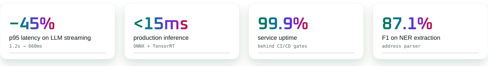
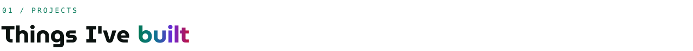
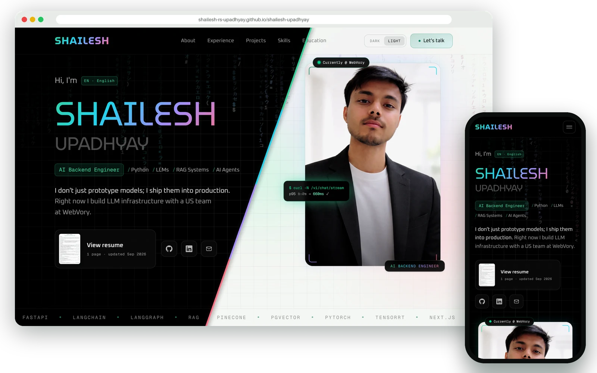
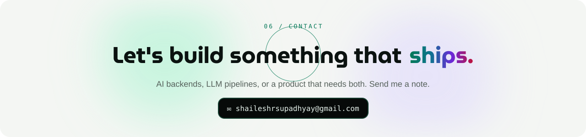

  

&nbsp;&nbsp;
&nbsp;&nbsp;

  

 

  
  
  
  

**RADAR** [live](https://radar-neon-theta.vercel.app/) · [code](https://github.com/SHAILESH-RS-UPADHYAY/radar) &nbsp;│&nbsp;
**Vettly** [code](https://github.com/SHAILESH-RS-UPADHYAY/vettly) &nbsp;│&nbsp;
**EVES** private, demo on request &nbsp;│&nbsp;
**Simplify Money** [code](https://github.com/SHAILESH-RS-UPADHYAY/simplify-money-backend) · [API](https://simplify-money-backend.onrender.com/docs)

More: <b>Inkly</b> print-on-demand mobile app · <a href="https://github.com/SHAILESH-RS-UPADHYAY/webvory-scalable-analytics-engine"><b>Analytics Engine</b></a> 1.3M records under 2s · <a href="https://github.com/SHAILESH-RS-UPADHYAY/autoflow"><b>AutoFlow</b></a> GenAI reports · <a href="https://github.com/SHAILESH-RS-UPADHYAY/finance-dashboard-backend"><b>Finance API</b></a> role-based access

 

  

| Feature | What you'll see |
| :-- | :-- |
| **Neural boot** | A neural net draws itself, "hello" decodes in four scripts, and *Hi, Welcome* assembles from its nodes. Click or press any key to skip. |
| **14-language hero** | *Hi, I'm Shailesh* in English, हिन्दी, தமிழ், తెలుగు, മലയാളം, संस्कृतम्, 日本語, 한국어, Русский, Deutsch, Svenska, Norsk, Lëtzebuergesch and Schwiizerdütsch, revealed by a scanner wipe. |
| **Self-typing terminals** | Every experience, project and skill box decrypts and types itself as it scrolls in. Spend 6 seconds with one and it stays written. |
| **Live project HUDs** | RADAR's phosphor scope locking onto a 91% match, Vettly's rail interlocking failing over from a rate-limited Groq to Gemini, EVES's self-writing mission brief and neon prompt pills. Each is built from the product's own brand and workflow. |
| **Spatial logos** | visionOS-style glass discs with depth layers that tilt toward your cursor. |
| **Two themes** | Dark by default. A sun ↔ moon switch spreads the other theme across the page in a circle; light mode is a paper lab with aurora light and floating screens. [`?theme=light`](https://shailesh-rs-upadhyay.github.io/shailesh-upadhyay/?theme=light) opens it directly. |
| **Any screen** | Audited on 18 viewports, from a 320px phone to 4K, with zero overflow. Big monitors scale the whole layout up. |
| **Contact console** | Email with a compose picker (Gmail, Outlook, Yahoo, mail app), plus call and WhatsApp in one tap. |
| **Accessible motion** | Honors reduced motion, keeps keyboard focus visible, and ships a skip link. |

 

  This site: 
  
  
  
  
  
  

 

  
  
  
  

  
    © 2026 Shailesh Upadhyay · All rights reserved. 
    This repository is published for viewing only. Please experience the work live at
    <a href="https://shailesh-rs-upadhyay.github.io/shailesh-upadhyay/"><b>shailesh-rs-upadhyay.github.io/shailesh-upadhyay</b></a>
    rather than cloning, copying or redeploying it.
  

